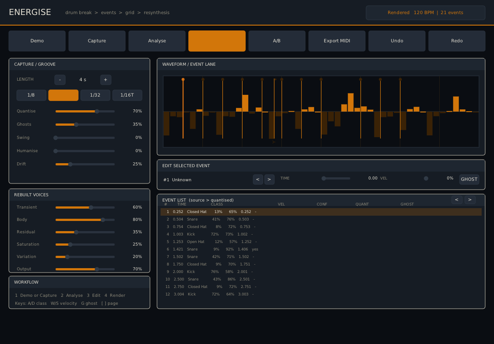

# Energise

Energise is an exploratory offline drum-break re-quantiser and resynthesiser. It
captures 1–8 seconds from stereo inputs 1/2 (default 4 seconds), or loads a
built-in six-second demo break, then detects onsets, fits a tempo/grid, labels
each hit with a portable rule classifier and presents the result as an editable
event list.

The workflow is **Demo/Capture → Analyse → Edit → Render → A/B**. After
analysis the waveform panel shows source hits and their quantised targets with
arrows; the table shows time, class, velocity, confidence, quantised time and
ghost status. Click a marker or row to select an event, then use the edit strip
or keys `A`/`D` (class), `W`/`S` (velocity), `G` (ghost) and `[`/`]` (page). Edits
are ordinary parameter values committed by the **Edit Event** counter, so VST3
hosts forward them reliably.

The renderer rebuilds each hit from a transient, a tuned drum body and a
filtered residual of the original audio. Quantise, Ghosts, Swing, Humanise,
Drift and the voice levels shape the result. **A/B** swaps the monitored audio
between capture and render; it does not replace the host's input. **Export MIDI**
queues the event list as GM drum notes on channel 10, respecting mute/solo masks.

The project is stored as versioned text state. Controls, status, waveform peaks
and the visible event-list shadow are host parameters, so the UI can show live
processor state without a DSP→UI callback. There is no ML model, WAV import or
real-time triggered playback in this first pass.

See `docs/energise-plan.md`, `docs/energise-progress.md` and
`docs/drumloop-energise-overview.md` for the plan, phase status and design
background.
