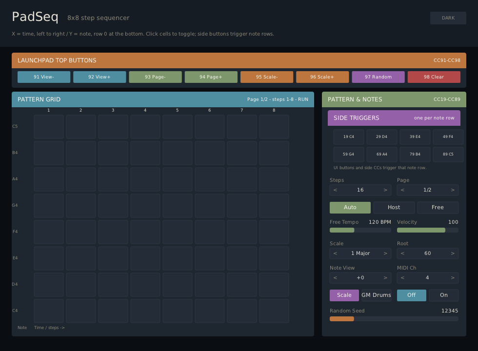

# PadSeq

PadSeq is a paged 8x8 MIDI step sequencer built around a Novation Launchpad Mini MK3
or X-style controller in programmer mode. It also works entirely from its own UI.

The grid is a note/time matrix. Columns are notes and rows are time, so a page
shows eight consecutive sixteenth-note steps. A pattern is 1-32 steps (default
16) across up to four pages. Each cell is its own host parameter, so the whole
pattern is saved and recalled by the host without plugin state.

The current scale is one of the 33 append-only ordinals in `docs/scales.md`,
including the canonical generic pentatonic row. **Note Map** can switch the eight
columns from scale degrees to General MIDI drums. **Root** and **Note View** move
the pitched columns; folding keeps emitted notes inside the MIDI range.

A connected Launchpad drives the same pattern:

- Grid pads toggle the cell under the current page.
- Top buttons move the note view, page and scale, randomise the pattern, or clear
  it and panic.
- Side buttons and the UI's side triggers play their column note with a note-off
  on the next grid step.
- LED feedback shows active cells, the current step, the visible page and the
  control colours.

Clock mode is **Auto** (host transport when available, otherwise free running),
**Host** (absolute bar/beat steps, restarting on start, jump and rewind), or
**Free** (internal tempo). The generated MIDI defaults to channel 4, leaving
Launchpad's channels 1-3 for LEDs.

## Hardware setup

Route the Launchpad's MIDI input into the track hosting PadSeq, and route that
track's MIDI output back to the controller. PadSeq sends the programmer-mode
SysEx on its first processing block, again after activation or a sample-rate
change, and whenever LED Feedback is toggled — even when LED Feedback is off.
Without that handshake a connected Launchpad stays in session mode and its pads
send CCs instead of the grid notes `11..88`, so it looks connected but does
nothing. LED Feedback defaults on and follows Plank's working path: grid LEDs use
channel-1 note-ons and top/side LEDs use channel-1 CCs, while generated notes
default to channel 4. Route MIDI to a synth set to channel 4 (or filter channels
1-3) so LED traffic is not heard as music. Clear also sends a hard all-off SysEx.

See `plugins/padseq/docs/design.md` for sequencing, state and Launchpad details.
